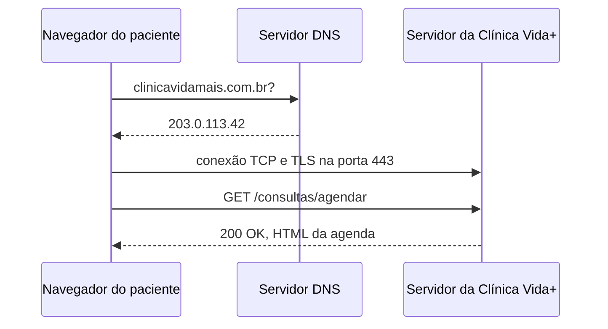

<!-- Evidências do DNS 
C:\Users\Aluno>nslookup www.uninove.br
Servidor:  ns3.uninove.br
Address:  186.251.39.123

Nome:    www.uninove.br
Address:  167.99.0.217

-->
<!-- Evidências do HTTP

1 Recurso: https://assets.uninove.br/cursos_2025-01-28-210040.jpg?mtime=20250128130040&focal=none  (IMG), método: GET, Cód 200
2 Recurso: https://assets.uninove.br/Home/coligadas.jpg?mtime=20201207143354&focal=none, Método: GET, Cód: 200
3 Recurso: https://assets.uninove.br/icons/colegio/icon-caderneta-inativo.png?mtime=20201015130456&focal=none Método: Get, Cód 200
4 Recurso: https://assets.uninove.br/icons/Layer-18.png?mtime=20201109093246&focal=none
Método: Get, Cód: 200
 -->
<!-- A clinica vida precisa de um HTTPS por motivos de segurança para que não haja vazamento de informações de requisições da Clínica, transmitindo assim qualquer tipo de informação íntima que possa ser acessada através de uma requisição  -->